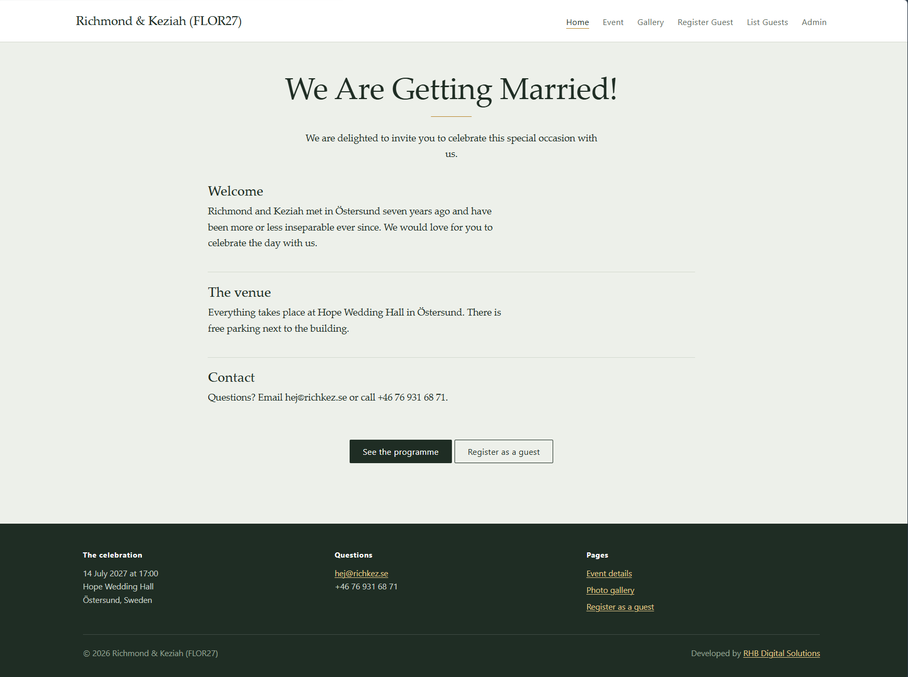
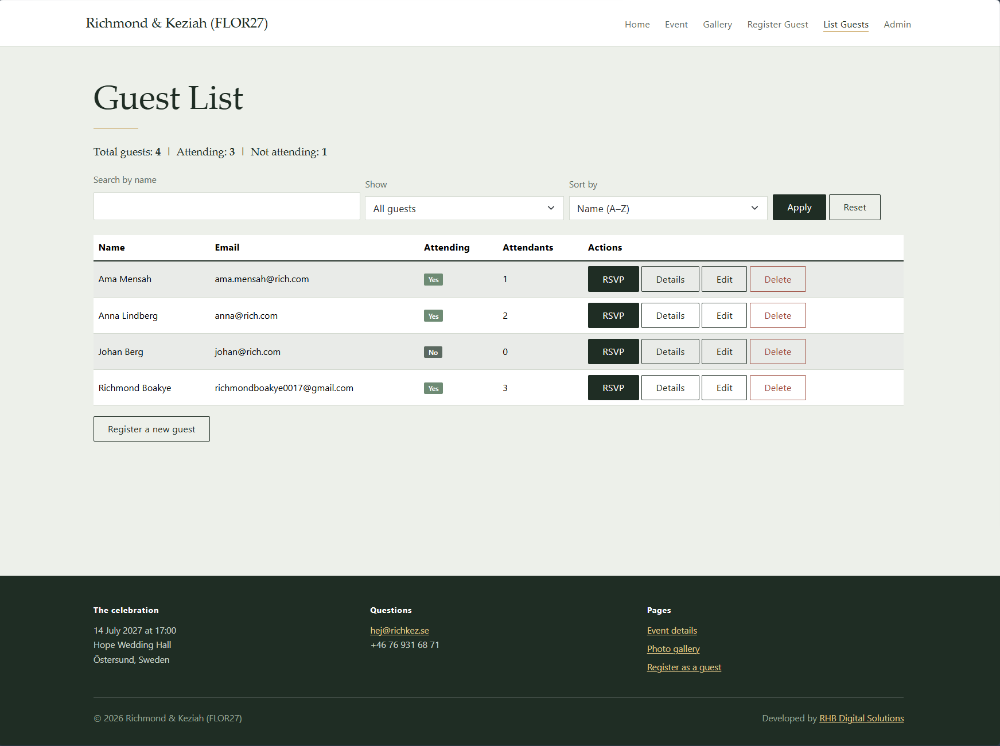
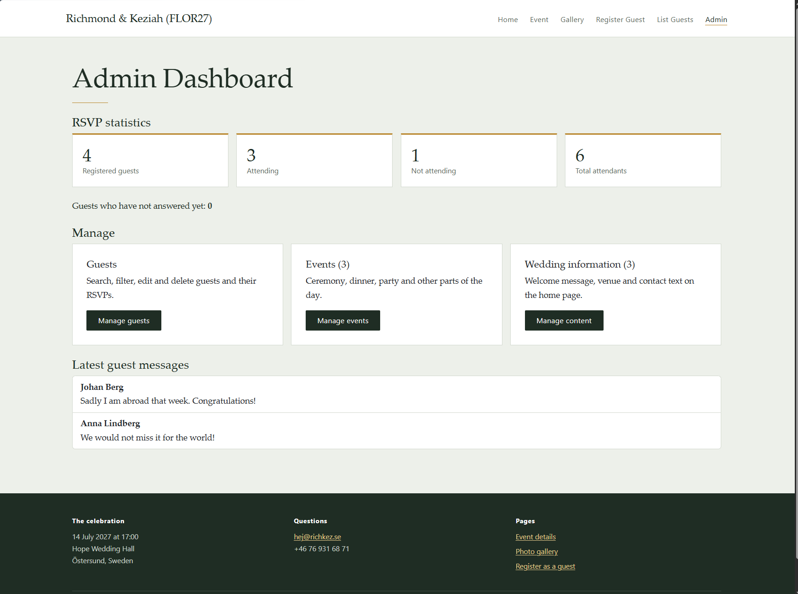

# WeddingAppMVC

A wedding website built with ASP.NET Core MVC and Entity Framework Core. Guests
register and respond to the invitation. The hosts manage guests, events and site
content from an admin section. All data is stored in a SQLite database.

This is the second version of the wedding website, rebuilt from Razor Pages to
MVC. Coursework for Programming in C# III at Malmö University.

## Built with

- C# / .NET 9
- ASP.NET Core MVC (controllers and strongly typed views)
- Entity Framework Core 9 with SQLite
- Bootstrap 5 (CSS only)

## Features

**Guests and RSVP**
- Register a guest with name, email and phone number
- RSVP page for each guest: attendance, number of attendants and a message
- An RSVP updates the existing guest record instead of creating a new one
- Confirmation page with a different message for attending and not attending

**Guest list**
- Search guests by name
- Filter by attending, not attending or no response yet
- Sort by name, RSVP status or registration date
- Totals for registered, attending and not attending guests
- Details, edit and delete, with a confirmation page before any delete

**Administration**
- Dashboard with RSVP statistics calculated from the database
- Event management: create, edit and delete the events of the day
- Wedding information management: edit the text blocks on the home page
- Latest guest messages on the dashboard

**Data**
- SQLite database managed through EF Core migrations
- Sample guests, events and home page content seeded by the first migration
- A second migration (`AddPhoneNumber`) adds a column to an existing table
- All database calls use `async` / `await`

## Screenshots

| Home | Guest list |
| --- | --- |
|  |  |

| Admin dashboard |
| --- |
|  |

## Project structure

```
WeddingAppMVC/
├── Controllers/
│   ├── HomeController.cs         Home page, gallery, error page
│   ├── EventController.cs        Public event page and event management
│   ├── GuestController.cs        Register, list, RSVP, details, edit, delete
│   ├── WeddingInfoController.cs  Home page text blocks
│   └── AdminController.cs        Dashboard with statistics
├── Data/
│   └── ApplicationDbContext.cs   DbSets and seed data
├── Migrations/                   InitialCreate and AddPhoneNumber
├── Models/                       Guest, Event, WeddingInfo
├── ViewModels/                   RsvpViewModel, GuestListViewModel, DashboardViewModel
├── Views/                        One folder per controller, plus Shared/_Layout.cshtml
├── wwwroot/                      CSS, images, Bootstrap
├── appsettings.json              Connection string
└── Program.cs                    Registers MVC and the DbContext
```

## Running the project

Requires the .NET 9 SDK and Visual Studio 2022.

1. Clone the repository and open `WeddingAppMVC.sln`.
2. Build the solution so the NuGet packages are restored.
3. Open **Tools → NuGet Package Manager → Package Manager Console** and run:

```
   Update-Database
```

   This applies both migrations and creates `Wedding.db` with the sample data.
4. Start the app with F5.

Command line alternative:

```bash
git clone https://github.com/Richmondbh/WeddingAppMVC.git
cd WeddingAppMVC
dotnet tool install --global dotnet-ef
dotnet ef database update
dotnet run
```

To inspect the tables, open `Wedding.db` in
[DB Browser for SQLite](https://sqlitebrowser.org/).

## Design decisions

**The RSVP form uses a view model.** On the `Guest` entity, `WillAttend` is
optional, because a newly registered guest has not answered yet. On the RSVP
form, the answer is required. `RsvpViewModel` carries that rule, so the entity
and the form can each have the validation that fits them.

**Edits copy values onto the stored entity.** The edit and RSVP actions load the
existing row and copy the submitted fields onto it. Values that are not on the
form, such as `RegisteredOn`, are never overwritten. `[Bind]` limits which fields
each form may set.

**Queries are built step by step.** The guest list starts from
`IQueryable<Guest>` and adds `Where` and `OrderBy` clauses depending on the
chosen search, filter and sort. The database is queried only once, at
`ToListAsync()`.

**Deletes ask first.** Every delete link opens a confirmation page, and the row
is only removed by the POST from that page.

**Seed data uses fixed dates.** `HasData` values must be constants. Using
`DateTime.Now` would make every new migration try to update the seed rows.

## Author

Richmond
